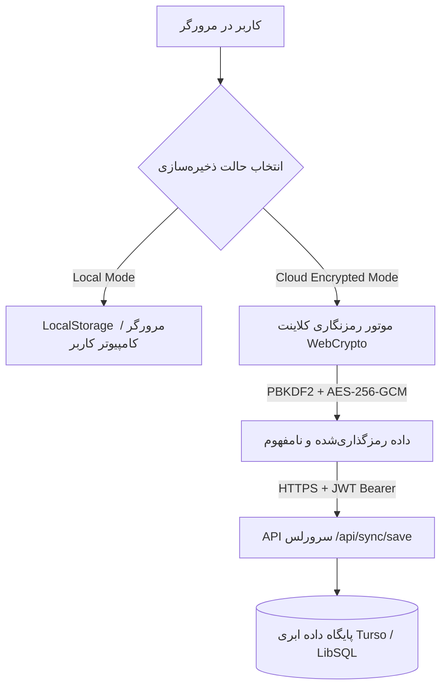
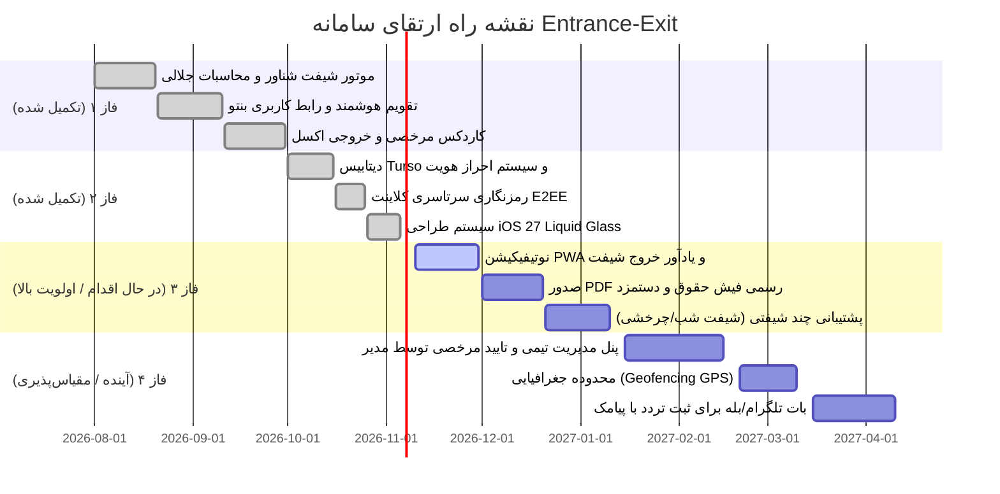

# 🧭 راهنمای جامع معماری، عملکرد و نقشه راه سامانه (Entrance-Exit System Guide)

> **توجه برای هوش مصنوعی و توسعه‌دهندگان:**  
> این سند، **مرجع اصلی و نقشه کامل (Source of Truth)** سامانه مدیریت تردد و کارکرد است. هر زمان که قصد ویرایش، توسعه، دیباگ یا افزودن ویژگی جدید به پروژه را دارید، **ابتدا این فایل را با دقت مطالعه فرمایید** تا ساختار، قوانین کسب‌وکار، معماری امنیت، سیستم طراحی و نقشه راه را کاملاً درک کنید.

---

## 📑 فهرست مطالب
1. [معرفی کلی و هدف سامانه](#۱-معرفی-کلی-و-هدف-سامانه)
2. [پشته فنی (Tech Stack)](#۲-پشته-فنی-tech-stack)
3. [معماری پروژه و ساختار پوشه‌ها](#۳-معماری-پروژه-و-ساختار-پوشه‌ها)
4. [سیستم طراحی iOS 27 Liquid Glass & Dynamic Fluid Mesh](#۴-سیستم-طراحی-ios-27-liquid-glass--dynamic-fluid-mesh)
5. [قوانین کسب‌وکار و هسته محاسباتی (Business Logic)](#۵-قوانین-کسب‌وکار-و-هسته-محاسباتی-business-logic)
6. [امنیت و ذخیره‌سازی داده‌ها (E2EE & Turso DB)](#۶-امنیت-و-ذخیره‌سازی-داده‌ها-e2ee--turso-db)
7. [کامپوننت‌ها و بخش‌های اصلی رابط کاربری](#۷-کامپوننت‌ها-و-بخش‌های-اصلی-رابط-کاربری)
8. [نقشه راه توسعه (Roadmap)](#۸-نقشه-راه-توسعه-roadmap)
9. [راهنمای توسعه، تغییر و نگهداری (Developer & AI Instructions)](#۹-راهنمای-توسعه-تغییر-و-نگهداری-developer--ai-instructions)
10. [متغیرهای محیطی و راه‌اندازی (Setup & Environment)](#۱۰-متغیرهای-محیطی-و-راه‌اندازی-setup--environment)

---

## ۱. معرفی کلی و هدف سامانه

سامانه هوشمند مدیریت تردد و کارکرد (**Entrance-Exit**) یک وب‌اپلیکیشن مدرن، پیشرو و اختصاصی برای **ثبت ورود و خروج روزانه، مدیریت شیفت شناور کاری، محاسبه بلادرنگ اضافه کاری، تاخیر، تعجیل، کسر کار، کاردکس مرخصی‌ها و صدور گزارش‌های استاندارد اداری و مالی** مبتنی بر **تقویم هجری شمسی (جلالی)** است.

### ویژگی‌های کلیدی سیستم:
* **طراحی آینده‌نگرانه iOS 27 Liquid Glass:** رابط کاربری هایپرفیوچریستیک با شیشه متراکم کوارتز، انکسار نوری زنده، تعقیب کرسر ماوس و پس‌زمینه سیال اوربیتال.
* **مبتنی بر تقویم شمسی جلالی:** سازگاری ۱۰۰٪ با تاریخ‌های ایران، سال کبیسه جلالی و دیتابیس تعطیلات رسمی کشور.
* **شیفت کاری شناور (Floating Shift):** پشتیبانی از بازه مجاز ورود صبحگاهی و خروج متناظر عصرانه بدون ثبت ناعادلانه تاخیر.
* **شمارش معکوس و زمان خروج هدف زنده:** تخمین و نمایش دقیق زمان خروج موظفی به محض ثبت ورود به همراه تایمر زنده و پروگرس‌بار.
* **معماری دومنظوره ذخیره‌سازی (Local + Zero-Knowledge Cloud):** قابلیت استفاده آفلاین محلی در مرورگر یا همگام‌سازی ابری رمزنگاری‌شده با استاندارد نظامی **AES-256-GCM**.
* **کاردکس جامع مرخصی:** پشتیبانی از مرخصی ساعتی، نیم‌روز، روزانه، استعلاجی و بدون حقوق با محاسبه کسر هوشمند از سهمیه ماهانه (۲.۵ روز معادل ۲۰ ساعت).
* **خروجی اکسل رسمی (`.xlsx`) و فیش پرینت:** صدور گزارش جامع قابل ارائه به حسابداری و مدیریت مالی.

---

## ۲. پشته فنی (Tech Stack)

| لایه | فناوری | توضیحات |
| :--- | :--- | :--- |
| **Frontend Framework** | **React 19** + **TypeScript** | استفاده از آخرین قابلیت‌های React 19، تایپ‌های قوی و ایمن |
| **Build Tool & Bundler** | **Vite 8** | بیلد فوق‌العاده سریع با HMR و پلاگین شبیه‌ساز سرورلس محلی |
| **Styling & Design System** | **Tailwind CSS v4** + **iOS 27 Liquid Glass** | انکسار فیزیکی شیشه، حباب‌های نوری مداری و تعقیب نوری ماوس |
| **Icons & Visuals** | **Lucide React** + **Canvas Confetti** | آیکون‌های وکتور استاندارد و انیمیشن پایان شیفت کاری |
| **Calendar Engine** | `jalaali-js` + تقویم سفارشی | تبدیل دقیق تاریخ‌ها، گرید ماه‌های شمسی و تعطیلات رسمی |
| **Spreadsheet Export** | `xlsx` (SheetJS) | صدور فایل اکسل رسمی با رنگ‌بندی و فرمول‌های ستونی |
| **Database & Cloud** | **Turso (LibSQL / SQLite)** | دیتابیس توزیع‌شده در لبه شبکه برای کاربران و بکاپ ابری |
| **Backend & Serverless** | **Vercel Functions / Node.js** | توابع سرورلس API در مسیر `/api/*` با پشتیبانی از تست لوکال |
| **Security & Auth** | **JWT** + **Bcrypt.js** + **Web Crypto API** | توکن احراز هویت، هشینگ پسورد و رمزنگاری کلاینت‌ساید AES-GCM |

---

## ۳. معماری پروژه و ساختار پوشه‌ها

```plaintext
entrance-exit-main/
├── api/                           # بک‌اند سرورلس (Vercel Functions & Turso DB)
│   ├── _lib/                      # توابع مشترک بک‌اند
│   │   ├── auth.ts                # صدور و اعتبارسنجی JWT توکن‌ها
│   │   ├── db.ts                  # کلاینت LibSQL (Turso) و تعاریف جداول پایگاه داده
│   │   └── response.ts            # هلپرهای فرمت‌بندی خروجی JSON و CORS
│   ├── auth/                      # اندپوینت‌های احراز هویت
│   │   ├── register.ts            # ثبت نام کاربر جدید
│   │   ├── login.ts               # ورود به سامانه و صدور توکن
│   │   ├── me.ts                  # دریافت اطلاعات کاربر جاری بر اساس توکن
│   │   └── change-password.ts     # تغییر کلمه عبور کاربر لاگین‌شده
│   ├── sync/                      # همگام‌سازی ابری رمزنگاری‌شده
│   │   ├── save.ts                # ذخیره پیلود رمزنگاری‌شده کاربر در دیتابیس
│   │   └── load.ts                # بازیابی پیلود رمزنگاری‌شده از دیتابیس
│   └── status.ts                  # بررسی وضعیت اتصال به پایگاه داده Turso
│
├── docs/                          # اسناد و راهنماهای پروژه
│   └── PROJECT_GUIDE.md           # همین فایل (راهنمای جامع معماری، قوانین و نقشه راه)
│
├── src/                           # هسته فرانت‌اند اپلیکیشن
│   ├── assets/                    # دارایی‌های استاتیک و آیکون‌ها
│   ├── components/                # کامپوننت‌های رابط کاربری
│   │   ├── AttendanceTable.tsx    # جدول کامل تردد ماهانه با فیلترها و جمع کل
│   │   ├── AuthScreen.tsx         # صفحه لاگین و ثبت‌نام شیشه‌ای بنتو
│   │   ├── BackupModal.tsx        # مدال خروجی/ورودی JSON و ریست دیتا
│   │   ├── ChangePasswordModal.tsx# مدال تغییر پسورد کاربر
│   │   ├── ClockCard.tsx          # کارت ساعت زنده، دکمه‌های ورود/خروج و تایمر
│   │   ├── DashboardCharts.tsx    # نمودارهای آماری و بصری‌سازی کارکرد
│   │   ├── LeaveModal.tsx         # فرم ثبت/ویرایش مرخصی (ساعتی، روزانه و ...)
│   │   ├── LeavesTab.tsx          # تب کاردکس مرخصی‌ها با درصد مصرف سهمیه
│   │   ├── LiquidGlassCard.tsx    # کامپوننت پایه شیشه فیزیکی کوارتز با تعقیب ماوس
│   │   ├── LiquidMeshBackground.tsx# موتور متحرک اوربیتال نوری با فیلتر نویز آنالوگ
│   │   ├── ManualEntryModal.tsx   # فرم ثبت دستی تردد برای هر تاریخ مشخص
│   │   ├── Navbar.tsx             # داک معلق visionOS و هدر بالایی
│   │   ├── PersianCalendar.tsx    # تقویم ماهانه هوشمند شمسی با رویدادها
│   │   ├── RecentActivityCard.tsx # کارت مینی آخرین ترددهای ثبت‌شده
│   │   ├── ReportsTab.tsx         # تب گزارش جامع تحلیلی، حقوقی و پرینت فیش
│   │   ├── SettingsModal.tsx      # مدال تنظیمات شیفت، ناهار، پنج‌شنبه، ضرایب
│   │   ├── StatsCards.tsx         # کارت‌های آماری بنتو (Bento KPI Cards)
│   │   ├── StorageModeModal.tsx   # مدال تغییر حالت ذخیره‌سازی (لوکال / ابری E2EE)
│   │   └── ThemeSelector.tsx      # پاپ‌اوور انتخاب پالت‌های رنگی برنامه
│   │
│   ├── context/                   # مدیریت وضعیت سراسری (Context API)
│   │   └── AuthContext.tsx        # مدیریت نشست، توکن، کاربر و همگام‌سازی ابری
│   │
│   ├── types/                     # تعاریف تایپ‌های تایپ‌اسکریپت
│   │   └── index.ts               # تمامی اینترفیس‌های AttendanceRecord, ShiftConfig, ...
│   │
│   ├── utils/                     # توابع کمکی و موتورهای محاسباتی
│   │   ├── api.ts                 # کلاینت HTTP ارتباط با اندپوینت‌های `/api/*`
│   │   ├── calculator.ts          # موتور محاسباتی کارکرد، اضافه کار، تاخیر و مرخصی
│   │   ├── crypto.ts              # موتور رمزنگاری کلاینت‌ساید AES-256-GCM با PBKDF2
│   │   ├── jalali.ts              # توابع تقویم جلالی، روزهای هفته و تعطیلات رسمی
│   │   ├── storage.ts             # ذخیره‌سازی ایزوله‌شده در LocalStorage و اکسپورت Excel
│   │   ├── theme.ts               # تنظیمات تم‌های برنامه
│   │   └── uiSettings.ts          # تنظیمات ظاهری رابط کاربری
│   │
│   ├── App.tsx                    # کامپوننت ریشه، روتینگ تب‌ها و هماهنگ‌کننده وضعیت
│   ├── index.css                  # سیستم طراحی Liquid Glass، کی‌فریم‌ها و متغیرها
│   └── main.tsx                   # نقطه ورود React و رندر درخت DOM
│
├── .env.example                   # نمونه متغیرهای اتصال Turso و JWT
├── package.json                   # پکیج‌ها و اسکریپت‌های اجرایی
├── tsconfig.json                  # تنظیمات کامپایلر تایپ‌اسکریپت
├── vercel.json                    # پیکربندی روتینگ و بیلد در سرویس Vercel
└── vite.config.ts                 # کانفیگ Vite به همراه شبیه‌ساز API محلی
```

---

## ۴. سیستم طراحی iOS 27 Liquid Glass & Dynamic Fluid Mesh

این معماری بصری بر پایه ۴ ستون اصلی (Core Pillars) الهام‌گرفته از نسل آینده سیستم‌عامل‌های اپل (visionOS / iOS) استوار است:

### ستون اول: موتور پس‌زمینه سیال (`LiquidMeshBackground.tsx`)
- **بوم عمیق:** زمینه پایه تاریک فضایی (`#07080f`).
- **حباب‌های نوری اوربیتال:** چهار گوی نوری با گرادیان‌های محو عمیق که در مدارهای مختلف به صورت پیوسته جابه‌جا می‌شوند:
  - *Blob 1 (بالا-چپ):* رنگ بنفش / نیلی الکتریک (`rgba(99, 102, 241, 0.45)`) با فیلتر `blur(120px)`.
  - *Blob 2 (مرکز-راست):* رنگ فیروزه‌ای / سایان نئونی (`rgba(6, 182, 212, 0.40)`) با فیلتر `blur(140px)`.
  - *Blob 3 (پایین-وسط):* رنگ سرخابی / ماژنتا (`rgba(236, 72, 153, 0.35)`) با فیلتر `blur(110px)`.
  - *Blob 4 (پایین-راست):* رنگ زمردی عمیق برای غنای طیف نوری پس‌زمینه.
- **لایه فیلتر گرین آنالوگ (Subtle Film Grain):** استفاده از نویز طبیعی SVG `feTurbulence` (`fractalNoise`) با شفافیت ۳٪ و حالت آمیختگی `mix-blend-mode: overlay` جهت حذف هرگونه Banding دیجیتال و تولید بافت شیشه‌ای کوارتز.

### ستون دوم: فیزیک انکسار و بازتاب شیشه‌ای (`LiquidGlassCard.tsx`)
- **ضریب شکست فیزیکی:** `backdrop-filter: blur(28px) saturate(210%) contrast(108%)`.
- **شفافیت متغیر سطح:** گرادیان مورب `linear-gradient(135deg, rgba(255, 255, 255, 0.12) 0%, rgba(255, 255, 255, 0.03) 100%)`.
- **لبه نئونی منشوری (Specular Edge Rim):** بردر کریستالی `1px solid rgba(255, 255, 255, 0.22)` به همراه لایه برجسته بالایی (`inset 0 1.5px 1px ...`).
- **شعاع انحنا:** انحنای نرم پیوسته `rounded-[28px]` تا `rounded-[34px]`.

### ستون سوم: بازتاب متحرک با تعقیب اشاره‌گر (Mouse-Tracking Sheen)
- رهگیری مختصات اشاره‌گر (`onPointerMove`) و ایجاد هاله بازتابی شعاعی زنده:
  `radial-gradient(380px circle at ${x}px ${y}px, ${sheenColor}, transparent 75%)`
- فیزیک لیفت معلق در حالت Hover با ایزینگ فنری (`cubic-bezier(0.16, 1, 0.3, 1)`).

### ستون چهارم: کنترل‌های کپسولی شیشه‌ای (Liquid Controls)
- دکمه‌های کپسولی مایع (`.liquid-pill-btn`, `.liquid-pill-btn-primary`) با حالت فشردگی نرم (`active:scale-[0.96]`).
- اینپوت‌های شیشه‌ای مقعر (`.liquid-input`) با سایه درونی و روشنایی تشدیدیافته در فوکوس.
- تایپوگرافی با کنتراست فوق‌العاده بالا (`text-white/95` برای هدینگ‌ها و `text-white/60` برای متاداده‌ها).

---

## ۵. قوانین کسب‌وکار و هسته محاسباتی (Business Logic)

تمام منطق محاسباتی سامانه در فایل [`src/utils/calculator.ts`](file:///f:/Work/Antigravity/entrance-exit-main/src/utils/calculator.ts) متمرکز است:

### ۱. شیفت شناور شنبه تا چهارشنبه (Normal Weekday Flexible Shift)
* **بازه ورود مجاز شناور:** از **۰۸:۳۰** الی **۰۹:۳۰** صبح.
  * ورود تا قبل از ۰۹:۳۰ **تاخیر محسوب نمی‌شود**.
  * ورود پس از ۰۹:۳۰ به اندازه دقایق مازاد بر ۰۹:۳۰ به عنوان **تاخیر ورود (`delayMinutes`)** ثبت می‌شود.
* **بازه خروج متناظر:** از **۱۷:۰۰** الی **۱۸:۰۰** عصر.
* **مدت حضور الزامی روزانه:** **۵۱۰ دقیقه** (معادل **۸ ساعت و ۳۰ دقیقه**).
* **کسر تایم ناهار/استراحت:** **۳۰ دقیقه** به صورت پیش‌فرض از حضور روزانه کسر می‌گردد.
* **کارکرد خالص موظفی مفید روزانه:** **۴۸۰ دقیقه** (معادل **۸ ساعت تمام**).
* **ساعت خروج هدف (`targetCheckOut`):**
  $$\text{Target Check-out} = \text{Check-in Time} + 510\text{ minutes}$$
  *مثال:* اگر کاربر در ساعت **۰۸:۴۵** وارد شود، ساعت خروج هدف او دقیقاً **۱۷:۱۵** خواهد بود.
* **تعجیل خروج (`earlyLeaveMinutes`):** اگر کاربر قبل از ساعت خروج هدف خارج شود، تفاوت آن به عنوان تعجیل ثبت می‌شود.
* **اضافه کاری روزانه (`overtimeMinutes`):** کارکرد خالص مازاد بر ۴۸۰ دقیقه.
* **کسر کار روزانه (`deficitMinutes`):** کارکرد خالص کمتر از ۴۸۰ دقیقه.
* **تراز روزانه (`netBalanceMinutes`):**
  $$\text{Net Balance} = \text{Overtime} - \text{Deficit}$$

### ۲. پنج‌شنبه‌ها (نیمه‌وقت)
* **مدت حضور الزامی:** **۲۴۰ دقیقه** (معادل **۴ ساعت**) طبق آخرین تنظیمات اداری (قابل تغییر در تنظیمات).
* **عدم کسر تایم ناهار:** در روزهای پنج‌شنبه به دلیل حضور کوتاه، تایم ناهار کسر نمی‌شود.
* کارکرد مازاد بر ۴ ساعت به عنوان اضافه کاری و کمتر از آن به عنوان کسر کار پنج‌شنبه منظور می‌گردد.

### ۳. جمعه‌ها و تعطیلات رسمی تقویم
* **موظفی روزانه:** **۰ دقیقه**.
* هرگونه حضور ثبت‌شده در روزهای جمعه یا تعطیل رسمی، به عنوان **اضافه کاری تعطیلات (`holidayOvertimeMinutes`)** با ضریب ویژه (پیش‌فرض **۱.۸**) محاسبه می‌گردد.

### ۴. کاردکس و قوانین مرخصی (Leaves System)
* **سهمیه ماهانه استاندارد:** **۲.۵ روز** در هر ماه کاری (معادل **۲۰ ساعت** یا ۱۲۰۰ دقیقه کارکرد مفید بر اساس روز ۸ ساعته).
* **انواع مرخصی مورد پشتیبانی:**
  1. **ساعتی (پاس ساعتی):** مشخص کردن دقیق ساعت شروع و پایان (مثلاً ۱۰:۰۰ تا ۱۲:۰۰) یا ورود تعداد ساعت/دقیقه.
  2. **نیم‌روز (Half-day):** معادل ۴ ساعت (۲۴۰ دقیقه).
  3. **روزانه کامل (Daily):** معادل ۸ ساعت (۴۸۰ دقیقه) که کل موظفی روز را پوشش می‌دهد.
  4. **استعلاجی (Sick Leave) و بدون حقوق (Unpaid Leave).**
* **همگام‌سازی بلادرنگ مرخصی با تردد:** تابع `syncRecordWithLeaves` به صورت خودکار با اضافه یا حذف مرخصی، وضعیت تردد همان روز را اصلاح می‌کند.

---

## ۶. امنیت و ذخیره‌سازی داده‌ها (E2EE & Turso DB)

معماری ذخیره‌سازی داده با رعایت کامل حریم خصوصی کاربران پیاده‌سازی شده است:



### ۱. حالت محلی آفلاین (`local`)
* تمام سوابق تردد، مرخصی‌ها و تنظیمات منحصراً در `localStorage` مرورگر ذخیره می‌شوند.
* برای هر کاربر لاگین‌شده، کلیدها با شناسه‌ی اختصاصی کاربر ایزوله می‌شوند:
  * `shamsi_attendance_records_${userId}`
  * `shamsi_shift_config_${userId}`
  * `shamsi_leave_records_${userId}`

### ۲. حالت ابری رمزنگاری سرتاسری (`cloud_encrypted`)
* قبل از ارسال داده‌ها به سرور، در مرورگر کلاینت با الگوریتم **AES-256-GCM** و کلید مشتق‌شده از شناسه کاربر به همراه نمک امنیتی (PBKDF2 با ۱۰۰,۰۰۰ بار تکرار و SHA-256) رمزنگاری می‌شود.
* سرور و پایگاه داده Turso صرفاً یک رشته متنی رمزشده (IV + Ciphertext) دریافت می‌کنند و **حتی مدیر دیتابیس نیز قادر به خواندن جزئیات ترددها نیست**.

---

## ۷. کامپوننت‌ها و بخش‌های اصلی رابط کاربری

برنامه به ۴ تب اصلی تقسیم شده است:

### ۱. تب داشبورد اصلی (`dashboard`)
* **ClockCard:** کارت شیشه‌ای ثبت زنده تردد، ساعت دیجیتال و آنالوگ، دکمه‌های ورود و خروج، تایمر شمارش مدت حضور، نمایش زمان دقیق خروج هدف، درصد پیشرفت شیفت و انیمیشن آتش‌بازی پیروزی (Confetti).
* **StatsCards (کارت‌های بنتو):** نمایش شاخص‌های عملکرد کلیدی ماه با رنگ‌بندی تفکیک‌شده نئونی.
* **تقویم شمسی جلالی (PersianCalendar):** تقویم ماهانه شیشه‌ای با خانه‌های شفاف، نشانگر تعطیلات رسمی و امکان ثبت تردد/مرخصی با کلیک روی هر روز.
* **نمودارهای داشبورد (DashboardCharts):** نمودار میله‌ای مقایسه کارکرد روزانه به همراه حلقه دونات تکمیل شیفت و تولتیپ شناور با لبه نئونی.
* **فعالیت‌های اخیر (RecentActivityCard):** مینی‌جدول شیشه‌ای آخرین ترددهای ثبت‌شده برای دسترسی سریع.

### ۲. تب جدول کارکرد (`timesheet`)
* **AttendanceTable:** جدول پیشرفته تردد ماهانه به تفکیک روز با لایه‌های شفاف، فیلترهای کپسولی افقی و فوتر محاسباتی دقیق.

### ۳. تب کاردکس مرخصی‌ها (`leaves`)
* **LeavesTab:** مدیریت یکپارچه مرخصی‌های ماهانه با نوار وضعیت مصرف سهمیه ۲۰ ساعته و تفکیک انواع مرخصی.

### ۴. تب گزارش‌های مالی و تحلیلی (`reports`)
* **ReportsTab:** گزارش رسمی سازگار با استانداردهای کارگزینی و حسابداری، محاسبه ارزش ریالی اضافه کار، پرینت فیش و صدور فایل اکسل.

---

## ۸. نقشه راه توسعه (Roadmap)



---

## ۹. راهنمای توسعه، تغییر و نگهداری (Developer & AI Instructions)

> [!IMPORTANT]
> **قوانین طلایی هنگام ویرایش کد پروژه:**
> ۱. **به هیچ وجه فرمول‌های پایه در `calculator.ts` را بدون هماهنگی تغییر ندهید:** محاسبات ۵۱۰ دقیقه حضور و ۳۰ دقیقه ناهار، ستون فقرات برنامه است.
> ۲. **حفظ استقلال تاریخ جلالی:** محاسبات تقویم همواره بر پایه سال و ماه جلالی (`jy`, `jm`, `jd`) است. هرگز تبدیل‌های خام میلادی را جایگزین توابع `jalali.ts` نکنید.
> ۳. **امنیت E2EE را نشکنید:** اطلاعات تردد و مرخصی نباید به صورت متن خام در دیتابیس ذخیره شوند؛ همیشه باید از مسیر `syncDataToCloud` عبور کنند.
> ۴. **یکپارچگی ایزوله‌سازی کاربر:** هر کلید جدیدی در `localStorage` ایجاد می‌کنید، باید به پسوند `${userId}` مجهز باشد.
> ۵. **هماهنگی با زبان طراحی Liquid Glass:** کلیه کامپوننت‌های جدید باید از `<LiquidGlassCard>` و کلاس‌های استاندارد `.liquid-pill-btn` و `.liquid-input` استفاده کنند.

### دستورات پرکاربرد در ترمینال:

* **نصب پکیج‌ها:**
  ```bash
  npm install
  ```
* **اجرای سرور توسعه (لوکال):**
  ```bash
  npm run dev
  ```
* **چک کردن خطاهای تایپ‌اسکریپت و بیلد نهایی:**
  ```bash
  npm run build
  ```
* **اجرای لینتر:**
  ```bash
  npm run lint
  ```

---

## ۱۰. متغیرهای محیطی و راه‌اندازی (Setup & Environment)

برای اتصال به پایگاه داده ابری Turso و احراز هویت سرورلس، فایل `.env` یا `.env.local` را در ریشه پروژه با مقادیر زیر تکمیل نمایید:

```env
# URL پایگاه داده ابری Turso (یا آدرس لوکال LibSQL)
TURSO_DATABASE_URL=libsql://your-database-name.turso.io

# توکن دسترسی دیتابیس Turso
TURSO_AUTH_TOKEN=your_turso_auth_token_here

# کلید رمزنگاری محرمانه برای صدور JWT
JWT_SECRET=your_super_secret_jwt_key_at_least_32_chars
```

> **نکته:** در صورتی که این متغیرها تنظیم نشده باشند، برنامه بدون هیچ مشکلی در **حالت آفلاین محلی (Local Mode)** اجرا می‌شود و تمام امکانات به صورت کامل در دسترس خواهد بود.

---

*سند بهینه‌سازی‌شده برای توسعه مستمر و راهنمایی عامل‌های هوشمند کدنویسی (AI Pair Programming).*
